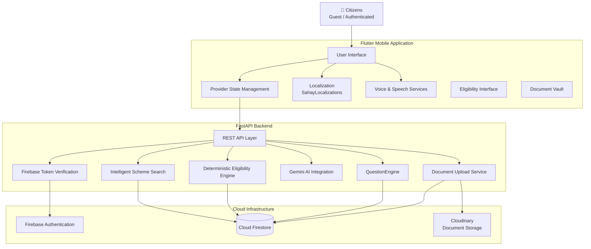
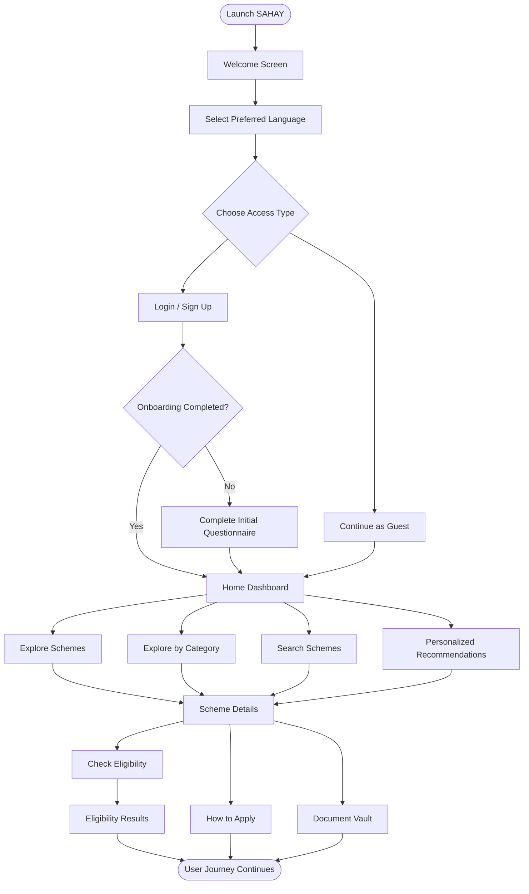
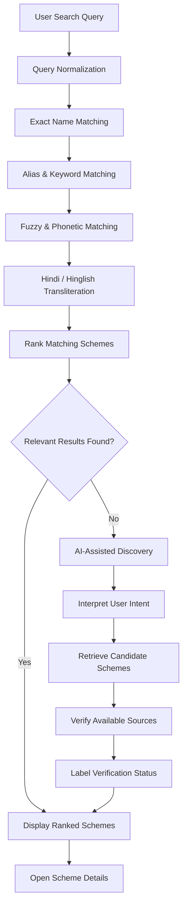
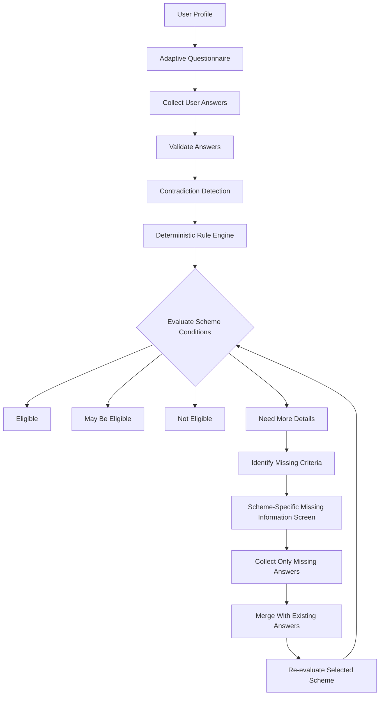
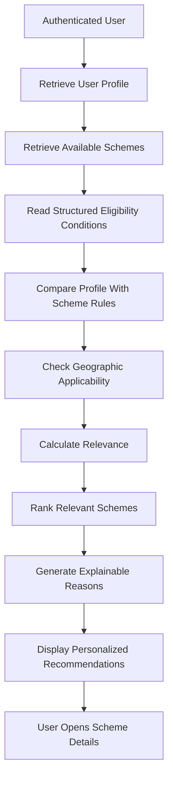
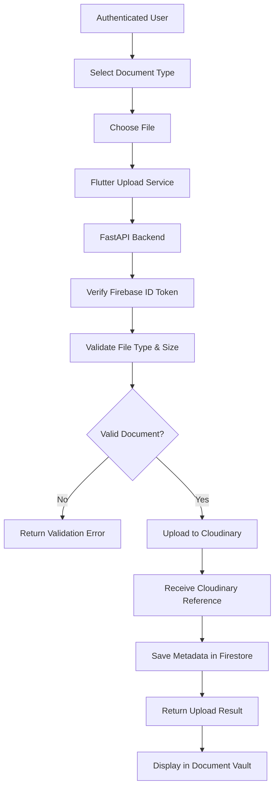
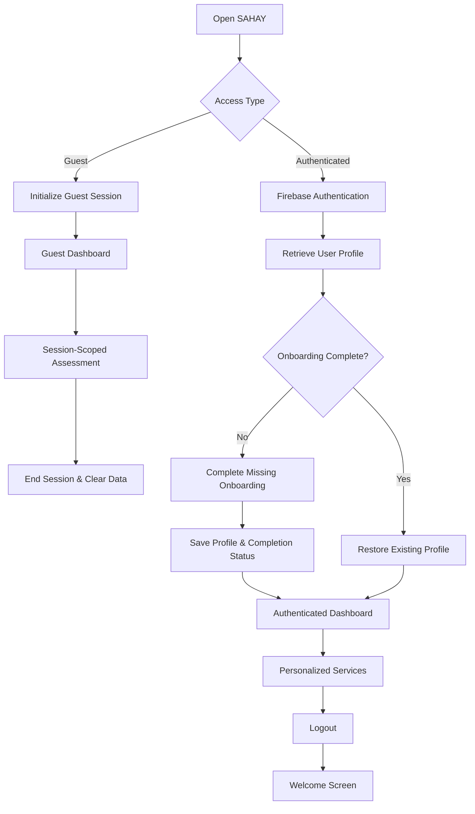

# 🏛️ SAHAY (सहाय)
### Your Gateway to Government Welfare Schemes

<p align="center">
  <strong>Discover. Understand. Apply.</strong>
</p>

<p align="center">
  An AI-powered, multilingual civic-tech platform designed to bridge the gap between Indian citizens and government welfare schemes.
</p>

<p align="center">
  
  
  
  
  
  
  
</p>

---

## 📌 1. About SAHAY

Millions of Indian citizens are eligible for government welfare schemes but struggle to discover them, understand complicated eligibility requirements, identify the necessary documents and complete application procedures.

**SAHAY (सहाय)** addresses this challenge through an intelligent, multilingual platform that simplifies access to government welfare schemes.

SAHAY combines deterministic eligibility assessment, AI-powered scheme discovery, secure document management, voice assistance and personalized guidance into one unified application.

It enables citizens to:

- Discover relevant Central and State government schemes.
- Search using partial names, keywords and natural-language queries.
- Understand eligibility through adaptive questionnaires.
- Identify missing information without repeating the entire assessment.
- Receive personalized scheme recommendations.
- Manage important documents securely.
- Access application guidance and official resources.
- Interact with the application in their preferred Indian language.

## 🎯 2. Problem Statement

Accessing government welfare schemes can be challenging because of:

- Lack of awareness about available government schemes.
- Complicated eligibility conditions and official terminology.
- Difficulty identifying the correct documents.
- Language barriers for citizens from different regions.
- Repeated visits to government offices for basic information.
- Limited understanding of application procedures.
- Difficulty determining which schemes are relevant to an individual.

## 💡 3. Our Solution

SAHAY provides a unified digital platform that simplifies the entire scheme discovery and eligibility assessment process.

Instead of manually searching through multiple government portals, citizens can discover schemes, assess their eligibility, understand missing requirements and access practical application assistance from one application.

**Our approach combines AI assistance with deterministic decision-making to provide transparent and explainable eligibility results.**

---

# ✨ 4. Key Features

## 4.1 🌐 Multilingual Experience

SAHAY supports eight Indian languages to make government information accessible to citizens across different regions.

| Language | Locale |
|---|---|
| English | `en` |
| Hindi | `hi` |
| Tamil | `ta` |
| Marathi | `mr` |
| Bengali | `bn` |
| Gujarati | `gu` |
| Kannada | `kn` |
| Odia | `or` |

**Highlights:**
- Global dynamic language switching.
- Centralized localization using `SahayLocalizations`.
- Global language state through `LocaleProvider`.
- Persistent language preferences.
- Localized scheme metadata.
- Language-aware AI assistance.
- Regional-language user interface.

## 4.2 🔍 Intelligent Scheme Discovery

Explore a catalogue of 100+ Central and State government welfare schemes across 13 canonical categories.

**Highlights:**
- Search by full or partial scheme names.
- Alias and keyword-based matching.
- Fuzzy and phonetic matching.
- Hindi and Devanagari transliteration support.
- Hinglish search support.
- Central and State scheme filters.
- State and Union Territory selection.
- Category-based scheme exploration.
- Personalized scheme recommendations.
- Debounced search and keyboard dismissal.
- Voice-based search.

## 4.3 🧠 Smart Eligibility Assessment

SAHAY uses a deterministic rule-based eligibility engine to evaluate scheme conditions against citizen-provided information.

**Eligibility classifications:**
- Eligible
- May Be Eligible
- Not Eligible
- Need More Details

**Highlights:**
- Adaptive questionnaires.
- Automatic progression after selecting answers.
- Boolean, categorical and range-based conditions.
- Contradiction detection.
- Informal household income estimation.
- Transparent eligibility explanations.
- Scheme-specific missing-information detection.
- Automatic re-evaluation after additional answers.

### Scheme-specific additional information

When a citizen selects **Provide Additional Information**, SAHAY identifies only the unresolved conditions for that particular scheme.

It does not restart the complete questionnaire or ask previously answered questions again.

## 4.4 👤 Personalized Scheme Recommendations

Authenticated users receive relevant scheme suggestions based on information already available in their profiles.

Recommendation factors may include:

- Age.
- State and location.
- Occupation.
- Education.
- Income, when provided.
- Other relevant profile information.

Each recommendation explains why a scheme may be relevant.

Missing information is not automatically interpreted as a negative answer.

## 4.5 📁 Secure Document Vault

A centralized document management system allows authenticated citizens to manage their important documents.

**Features:**
- Predefined document categories.
- Additional custom document types.
- Custom document naming.
- PDF, JPG and PNG support.
- Cloudinary-backed document storage.
- Firestore document metadata.
- Document preview.
- Replace and delete operations.
- Upload timestamps and file information.
- Reference document specimens.
- Integration with scheme-specific document checklists.

Document upload status is kept separate from official document verification.

## 4.6 📄 Document Reference Guide

Citizens can understand which documents are required and why they are needed.

The document guide provides:

- Document descriptions.
- Purpose and issuing authority.
- Important details to verify.
- Reference document layouts.
- Scheme-specific document checklists.
- Uploaded and missing document status.

## 4.7 🎙️ Voice Assistance

SAHAY improves accessibility through voice interaction.

- Speech-to-text for voice input.
- Text-to-speech for read-aloud assistance.
- Voice-enabled search and interaction.
- Regional-language experiences, subject to speech-engine availability.

## 4.8 🤖 AI-Powered Citizen Assistance

Google Gemini 2.5 API integration supports:

- Conversational scheme assistance.
- Natural-language scheme discovery.
- Simplified explanations.
- Citizen guidance.
- Language-aware responses.

**Important:** AI assists with understanding and communication. The deterministic eligibility engine remains responsible for evaluating scheme rules.

## 4.9 🏢 Common Service Centre (CSC) Locator

Helps citizens identify Common Service Centres and access assisted application support.

Features:

- State and district selection.
- PIN-code-based search.
- Village Level Entrepreneur information where available.
- Google Maps navigation.
- Direct calling where contact details are available.
- Official CSC locator access.
- National helpline: `1800-121-3468`.

Official locator: https://locator.csccloud.in/

## 4.10 📑 Eligibility Reports and Application Guidance

- Downloadable eligibility reports.
- PDF generation.
- Print and share functionality.
- Scheme application instructions.
- YouTube application tutorials where available.
- Official government portal links.

---

# 🏗️ 5. System Architecture

SAHAY follows a modular, API-driven architecture that separates the mobile interface, backend services, intelligent processing, authentication, database and cloud storage.

## 5.1 High-Level Architecture Diagram



## 5.2 Architecture Layers

| Layer | Technology | Responsibility |
|---|---|---|
| Presentation | Flutter, Dart | Citizen-facing mobile application |
| State management | Provider | Application state |
| Localization | SahayLocalizations | Eight-language support |
| API layer | FastAPI | Backend communication |
| Validation | Pydantic V2 | Structured request/response validation |
| Authentication | Firebase Authentication | User identity and sessions |
| Database | Cloud Firestore | Schemes, profiles and metadata |
| File storage | Cloudinary | Uploaded documents |
| AI assistance | Gemini 2.5 API | Conversational intelligence |
| Eligibility | Deterministic rule engine | Eligibility decisions |
| Voice | speech_to_text, flutter_tts | Voice interaction |
| PDF | pdf, printing | Report generation |
| Testing | Flutter Test, Pytest | Quality assurance |

---

# 🔄 6. Application Flowcharts

## 6.1 Overall User Journey



## 6.2 Intelligent Scheme Discovery Workflow



## 6.3 Smart Eligibility Assessment Workflow



## 6.4 Personalized Recommendation Workflow



## 6.5 Secure Document Upload Workflow



## 6.6 Persistent Onboarding and Guest Session Workflow



---

# 🧠 7. Core Intelligent Modules

## 7.1 Scheme Search Engine

The scheme discovery service combines multiple matching techniques:

| Technique | Purpose |
|---|---|
| Exact matching | Match official scheme names |
| Partial matching | Handle incomplete names |
| Alias normalization | Match common scheme names |
| Keyword indexing | Match descriptions and relevant terms |
| Fuzzy matching | Handle spelling mistakes |
| Phonetic matching | Match similar-sounding queries |
| Devanagari transliteration | Support regional search |
| Semantic assistance | Interpret natural-language intent |

Example:

| User query | Matching scheme |
|---|---|
| ladli behena yojna | Mukhyamantri Ladli Behna Yojana |
| pm kisan | PM-KISAN |
| ayushman | Ayushman Bharat PM-JAY |
| pm awas | Pradhan Mantri Awas Yojana |
| ujjwala | Pradhan Mantri Ujjwala Yojana |

## 7.2 Deterministic Eligibility Engine

Eligibility evaluation is based on structured scheme rules and citizen-provided answers.

Supported condition types include:

- Boolean conditions.
- Numeric range checking.
- Categorical matching.
- Geographic applicability.
- Required conditions.
- Exclusion conditions.
- Missing-information checks.
- Contradiction detection.

The engine distinguishes between:

- A condition that is satisfied.
- A condition that is not satisfied.
- A condition that cannot yet be evaluated.

Unknown values are not automatically treated as false.

## 7.3 Scheme-Specific Missing Information

The `SchemeMissingInfoScreen` provides a targeted follow-up experience.

It:

1. Identifies unresolved mandatory scheme conditions.
2. Retrieves only unanswered questions.
3. Displays the selected scheme's missing information.
4. Collects additional answers.
5. Merges answers with existing assessment data.
6. Re-evaluates the selected scheme.
7. Updates the result without restarting the full questionnaire.

---

# 🗄️ 8. Data Architecture

The following is a logical representation based on the application's described functionality, not a verified export of the actual Firestore schema.

| Collection / Entity | Description |
|---|---|
| `schemes` | Scheme names, benefits, eligibility, descriptions and sources |
| `categories` | Canonical scheme categories |
| `users` | UID, profile, language and onboarding information |
| `documents` | Document metadata and Cloudinary references |
| `application_drafts` | Application-related draft information, if enabled |
| Scheme video metadata | YouTube titles, IDs, URLs and verification details |

### Data Storage Separation

| Data | Storage |
|---|---|
| Government scheme records | Cloud Firestore |
| Scheme categories | Cloud Firestore |
| User profiles | Cloud Firestore |
| Document metadata | Cloud Firestore |
| Actual uploaded document files | Cloudinary |
| Language preferences | SharedPreferences / user profile |
| Guest assessment answers | In-memory session state |
| Temporary questionnaire state | Application providers |

---

# 🔐 9. Security and Privacy

SAHAY is designed with citizen data privacy in mind.

- Firebase Authentication for user identity.
- Backend-side Firebase ID token verification.
- Verified UID-based user isolation.
- Secure document upload architecture.
- Cloudinary-backed document storage.
- Firestore metadata management.
- Guest session isolation.
- In-memory guest assessment data.
- Session clearing functionality.
- No Cloudinary secrets in the Flutter client.

Sensitive documents must use authenticated/private delivery and appropriate access controls.

---

# 🛠️ 10. Technology Stack

## Frontend

- Flutter 3.35+
- Dart 3.9+
- Provider
- Material 3
- AppColors
- AppTextStyles
- AppTheme
- SahayLocalizations
- LocaleProvider
- speech_to_text
- flutter_tts
- interactive_viewer
- url_launcher
- pdf
- printing
- shared_preferences

## Backend

- Python 3.11+
- FastAPI
- Pydantic V2
- Uvicorn
- asyncio
- HTTPX
- Firebase Admin SDK

## AI and Intelligent Processing

- Google Gemini 2.5 API
- Deterministic eligibility rule engine
- Multi-keyword inverted index
- Alias normalization
- Fuzzy and phonetic matching
- Hindi transliteration
- Adaptive QuestionEngine
- Contradiction detection engine

## Cloud and Database

- Firebase Authentication
- Google Cloud Firestore
- Cloudinary

## Testing

- Flutter Test
- Pytest
- Flutter Analyze

---

# 📂 11. Project Structure

The following is a logical reference structure. Actual filenames and folders may differ.

```text
sahay/
│
├── assets/
│   ├── images/
│   ├── icons/
│   └── documents/
│
├── lib/
│   ├── core/
│   │   ├── localization/
│   │   ├── theme/
│   │   ├── constants/
│   │   └── utils/
│   │
│   ├── models/
│   ├── providers/
│   ├── screens/
│   │   ├── welcome/
│   │   ├── dashboard/
│   │   ├── schemes/
│   │   ├── eligibility/
│   │   ├── documents/
│   │   └── profile/
│   │
│   ├── services/
│   ├── widgets/
│   └── main.dart
│
├── backend/
│   ├── app/
│   │   ├── api/
│   │   ├── core/
│   │   ├── models/
│   │   ├── services/
│   │   └── main.py
│   │
│   └── tests/
│
├── test/
│
├── docs/
│
├── pubspec.yaml
└── README.md
```

---

# 🚀 12. Getting Started

## Prerequisites

Install the following:

- Flutter SDK 3.35+
- Dart SDK 3.9+
- Python 3.11+
- Android Studio or Xcode
- Firebase project configuration
- Cloudinary account
- Gemini API access

## Step 1 — Clone the Repository

```bash
git clone https://github.com/YOUR_USERNAME/sahay.git

cd sahay
```

Replace `YOUR_USERNAME` with the repository owner's GitHub username.

## Step 2 — Set Up Flutter

```bash
flutter pub get

flutter analyze
```

## Step 3 — Configure Firebase

Configure your Firebase project using the appropriate FlutterFire setup.

Ensure the required platform configuration files are present.

Enable the authentication methods used by the application and configure Firestore.

Never commit private service-account credentials.

## Step 4 — Configure the Backend

```bash
cd backend

python3 -m venv .venv

source .venv/bin/activate

pip install -r requirements.txt
```

If the repository uses `pyproject.toml` or another dependency manager, follow the existing project instructions.

## Step 5 — Configure Environment Variables

Create a backend `.env` file using the actual configuration names expected by the application.

Example:

```env
GEMINI_API_KEY=your_gemini_api_key

CLOUDINARY_CLOUD_NAME=your_cloud_name
CLOUDINARY_API_KEY=your_cloudinary_api_key
CLOUDINARY_API_SECRET=your_cloudinary_api_secret

# Configure Firebase Admin credentials
# using a secure server-side credential mechanism.
```

**Never commit `.env` files, private API keys or service-account credentials.**

## Step 6 — Start the Backend

```bash
uvicorn app.main:app --reload --port 8000
```

Backend:

```text
http://127.0.0.1:8000
```

API documentation:

```text
http://127.0.0.1:8000/docs
```

## Step 7 — Run the Flutter Application

Open a new terminal:

```bash
cd sahay

flutter run
```

For a physical device, configure the backend URL using the existing application configuration. Ensure the device and development machine can communicate over the network.

---

# 🧪 13. Testing and Quality Assurance

SAHAY includes unit and widget tests covering major functional modules.

## Latest Reported Test Status

| Metric | Reported Result |
|---|---|
| Flutter tests | 209 / 209 passing |
| Flutter static analysis | No issues found |
| Search focus tests | Covered |
| Missing-information tests | Covered |
| Voice animation overflow | Covered |
| Category exploration | Covered |
| Multilingual overflow | Covered |
| Guest navigation | Covered |
| Persistent onboarding | Covered |

### Run Flutter Tests

```bash
flutter test --no-pub
```

### Run Static Analysis

```bash
flutter analyze --no-pub
```

### Run Backend Tests

```bash
cd backend

python -m pytest -v tests
```

### Reported Test Modules

| Test file | Purpose |
|---|---|
| `search_focus_test.dart` | Search focus and keyboard dismissal |
| `scheme_missing_info_test.dart` | Scheme-specific missing information |
| `voice_input_overflow_test.dart` | Voice input animation overflow |
| `category_exploration_test.dart` | Category filtering and normalization |
| `overflow_regression_test.dart` | Responsive layouts and multilingual overflow |
| `phase4_guest_navigation_test.dart` | Guest session isolation |
| `phase3_persistent_onboarding_test.dart` | Persistent onboarding |

*The test metrics reflect the latest reported project test run and have not been independently re-executed for this README.*

---

# 🌱 14. Future Scope

Potential future enhancements include:

- Integration with additional verified government scheme sources.
- Improved document OCR and automated document validation.
- Application status tracking where official integrations are available.
- Expanded scheme coverage.
- More regional-language voice capabilities.
- Additional assisted application workflows.
- Improved accessibility for elderly and differently abled citizens.
- More secure government service integrations.

---

# 👥 15. Target Users

SAHAY is designed for:

- Farmers.
- Students.
- Women and families.
- Senior citizens.
- Economically weaker sections.
- Rural communities.
- Small business owners.
- Citizens seeking government welfare assistance.

---

# 🤝 16. Contributing

Contributions are welcome.

1. Fork the repository.
2. Create a feature branch.
3. Implement your changes.
4. Add or update relevant tests.
5. Run Flutter analysis and tests.
6. Submit a pull request with a clear description.

Please avoid committing API keys, private credentials or personal documents.

---

# ⚠️ 17. Disclaimer

SAHAY is an independent civic-tech assistance platform. It is not an official government application and is not affiliated with or endorsed by any government department.

Scheme information is provided for awareness and assistance. Eligibility assessments are indicative and do not guarantee approval or benefits.

Citizens should verify current eligibility conditions, application procedures and official requirements through the respective government authorities and portals.

---

# ❤️ 18. Our Vision

**Making government welfare accessible to everyone, regardless of language, location or technical knowledge.**

SAHAY aims to transform the way citizens discover, understand and access government welfare opportunities through technology, transparency and inclusivity.

<p align="center">
  <strong>SAHAY (सहाय) — Technology with a Purpose.</strong>
  <br/>
  <strong>सेवा से सशक्तिकरण।</strong>
</p>
