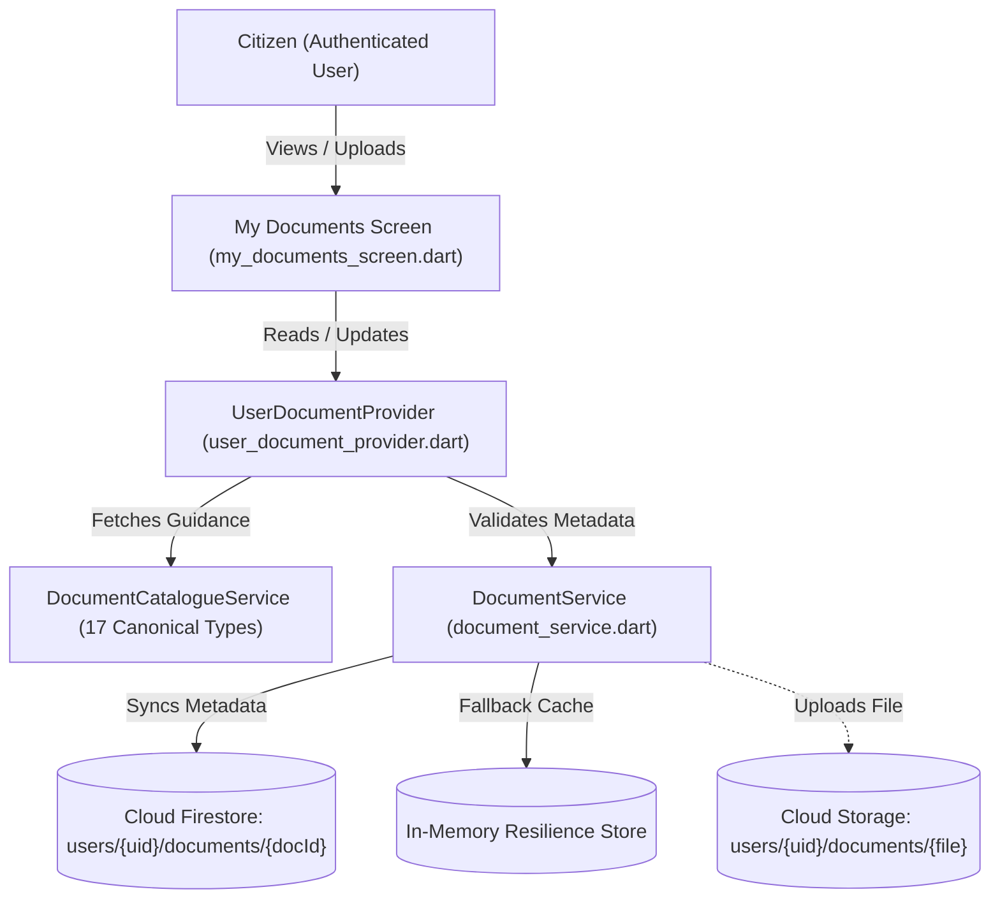

# SAHAY (सहाय) — My Documents Feature Implementation Report

## 1. Executive Summary

The **My Documents** feature provides registered Indian citizens with a private, secure, and user-centric document vault within SAHAY. In strict adherence to our digital sovereignty and privacy commitments, **document upload is 100% optional**. Citizens can discover schemes, evaluate eligibility, and generate checklists without ever uploading a file.

For citizens who choose to upload certificates for reference, SAHAY offers a structured repository supporting PDF, JPG, and PNG formats up to 5.0 MB with instant specimen previews, state-specific guidance, and automated checklist matching.

---

## 2. Architecture & Data Flow

---

## 3. Data Models

### 3.1 `UserDocumentModel` (`lib/models/user_document_model.dart`)
- **`documentId`**: Unique identifier format: `${userId}_${documentType}_${timestamp}`.
- **`userId`**: Authenticated UID matching Firebase Authentication.
- **`documentType`**: Canonical string identifier (e.g. `aadhaar_card`, `land_ownership_record`).
- **`documentName`**: User-facing localized title.
- **`storagePath`**: Private storage reference: `users/{userId}/documents/{documentId}.{ext}`.
- **`fileType`**: File format (`pdf`, `jpg`, `png`).
- **`fileSize`**: File size in bytes.
- **`uploadedAt` / `updatedAt`**: ISO timestamp objects.
- **`verificationStatus`**: Status label (e.g. `'uploaded'`, `'unverified'`).
- **`notes`**: Optional user-provided reference notes (e.g., "Renewed in 2024").

### 3.2 Canonical Document Types (`DocumentCatalogueService`)
The vault standardizes across 17 official Indian government document types:
1. `aadhaar_card`: Aadhaar Card (UIDAI)
2. `land_ownership_record`: Land Record (Khatauni / Khasra / RoR)
3. `bank_passbook`: Bank Account Passbook / Cancelled Cheque
4. `ration_card`: Ration Card (NFSA / BPL / AAY)
5. `samagra_id`: MP Samagra Family & Member ID (SSSM)
6. `income_certificate`: Income Certificate (Revenue Dept / Tehsildar)
7. `domicile_certificate`: Permanent Domicile Certificate
8. `caste_certificate`: Caste Certificate (SC / ST / OBC)
9. `ews_certificate`: Economically Weaker Section Certificate
10. `marksheet_12th`: Class 12th Marksheet & Admission Proof
11. `marksheet_10th`: Class 10th Matriculation Certificate
12. `mgnrega_job_card`: MGNREGA Job Card
13. `disability_certificate`: UDID Disability Certificate
14. `voter_id`: Electoral Photo Identity Card (EPIC)
15. `pan_card`: Permanent Account Number Card
16. `residence_certificate`: Utility Bill / Domestic Address Proof
17. `other_document`: Supporting Affidavits / Discharge Books

---

## 4. Key Functional Features

1. **File Type and Size Validation**:
   - Strictly accepts `.pdf`, `.jpg`, `.jpeg`, and `.png`.
   - Rejects executable, archive, or media files.
   - Enforces a strict ceiling of **5,242,880 bytes (5.0 MB)**.
   - Rejects empty (0-byte) files.
2. **Category Filters**:
   - Filter documents by: All, Identity, Land, Banking, Income, Address, Education, and Other.
3. **Replace & Update**:
   - Allows citizens to replace expired certificates (e.g. annual income certificates or land records) while preserving document linkage.
4. **Permanent Deletion**:
   - One-tap deletion with immediate metadata and cache eradication.
5. **Session Wipe & Shared Phone Integration**:
   - Integrated with SAHAY's Shared Phone mode: `deleteAllUserDocuments` purges local cache upon session completion.

---

## 5. Security & Zero-Retention Compliance

- **No Plaintext Sensitive Identifiers**: Firestore rules explicitly forbid persisting raw 12-digit Aadhaar numbers, PAN numbers, or bank account numbers in document metadata.
- **Owner-Only Isolation**: Security rules enforce `request.auth.uid == userId`. No cross-user reads, queries, or updates are permissible.
- **Offline Resilience**: When running offline or in demo environments without Firebase credentials, `DocumentService` operates smoothly via an in-memory fallback store without crashes.

