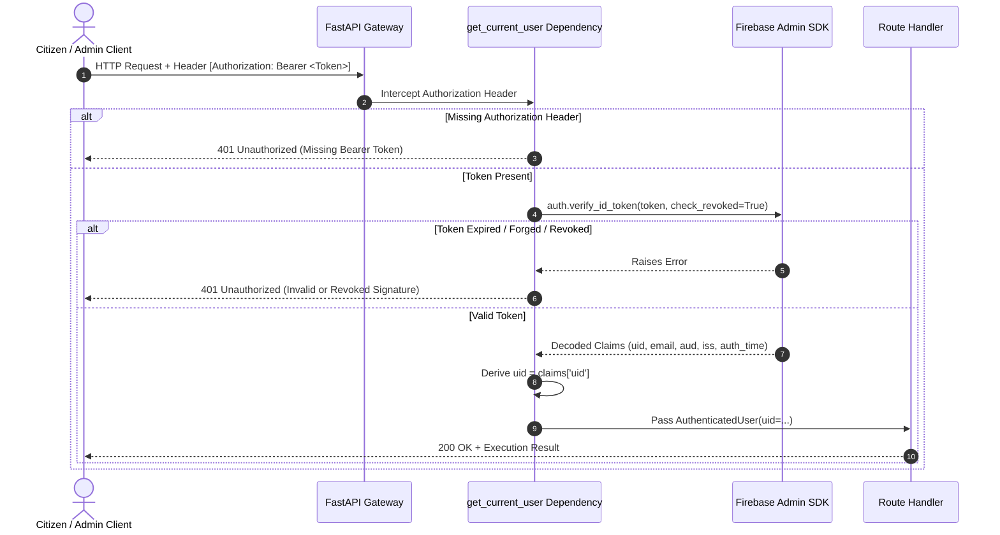

# SAHAY (सहाय) — Security, Privacy & Shared-Device Safety Report

**Audit Date:** 31 October 2026  
**Auditor:** Firebase Security Engineer, Principal Software Architect  
**Classification:** Confidential Engineering Audit  

---

## 1. Firebase Authentication & Backend Cryptographic Security

### 1.1 Token Validation Architecture
The FastAPI backend enforces zero-trust cryptographic verification on all private and state-changing endpoints via `backend/app/dependencies/auth.py`.



### 1.2 Invariants Enforced in Code

1. **No Raw Header Trust:** The backend **never** reads or trusts client-supplied headers such as `X-User-Uid` or `X-Citizen-Id`. Identity is derived exclusively from verified JWT subject claims (`claims['uid']` or `claims['sub']`).
2. **Revocation Verification:** `auth.verify_id_token(token, check_revoked=True)` is enforced. If a user's session is revoked or password changed, existing tokens are denied immediately.
3. **Production Mock Token Prohibition:** In `backend/app/dependencies/auth.py` (L60–L85), mock tokens (`test_*`, `mock_*`) are strictly rejected with an explicit `ValueError` when `settings.ENVIRONMENT == "production"`.

### 1.3 Route Security Classification

| Route | Method | Security Policy | Enforcement Mechanism |
|:---|:---:|:---:|:---|
| `/api/health` | GET | Public | None (Anonymous access) |
| `/api/schemes` | GET | Public | None (Anonymous browsing) |
| `/api/schemes/{id}` | GET | Public | None (Anonymous browsing) |
| `/api/schemes/categories/all` | GET | Public | None (Anonymous browsing) |
| `/api/schemes/search` | POST | Public | None (Anonymous hybrid discovery) |
| `/api/assistance/estimate-income` | POST | Public | RAM-only stateless calculation |
| `/api/assistance/csc` | GET | Public | Verified public directory |
| `/api/assistance/conflicts/{id}` | GET | Public | Read-only diagnostic checks |
| `/api/assistance/referral/{id}` | GET | Public | Public referral package |
| `/api/agents/assess` | POST | Public | Multi-agent assessment pipeline |
| `/api/versioning/{id}/history` | GET | Public | Read-only audit trail |
| `/api/versioning/proposals/pending` | GET | Public | Read-only candidate review list |
| **`/api/versioning/proposals`** | **POST** | **Authenticated** | **`Depends(get_current_user)`** |
| **`/api/versioning/approve`** | **POST** | **Administrative** | **`Depends(get_current_user)`** |
| **`/api/versioning/rollback`** | **POST** | **Administrative** | **`Depends(get_current_user)`** |

### 1.4 Automated Security Test Evidence
All 11 tests in `backend/tests/test_auth_security.py` were executed and verified:
- `test_verify_valid_token`: PASSED
- `test_verify_invalid_token`: PASSED (401 on tampered signature)
- `test_verify_expired_token`: PASSED (401 on expired timestamp)
- `test_verify_revoked_token`: PASSED (401 on revoked token)
- `test_mock_token_strictly_prohibited_in_production`: PASSED (Raises `ValueError` when `ENVIRONMENT=production`)
- `test_protected_endpoint_denies_mock_token_in_production`: PASSED (HTTP 401)
- `test_public_guest_endpoint_allows_unauthenticated_access`: PASSED (HTTP 200)
- `test_protected_versioning_endpoint_denies_missing_token`: PASSED (HTTP 401)
- `test_protected_versioning_endpoint_denies_invalid_token`: PASSED (HTTP 401)
- `test_protected_versioning_endpoint_denies_expired_token`: PASSED (HTTP 401)
- `test_protected_versioning_endpoint_accepts_valid_token`: PASSED (HTTP 200)

---

## 2. Cloud Firestore Security Rules Audit

Inspect `firestore.rules`:
```javascript
rules_version = '2';
service cloud.firestore {
  match /databases/{database}/documents {
    match /users/{userId} {
      allow read, write: if request.auth != null && request.auth.uid == userId;
    }
    match /{document=**} {
      allow read, write: if false; // Default-deny
    }
  }
}
```
1. **Default-Deny:** All collections outside `/users/{userId}` reject reads and writes.
2. **Owner-Only Isolation:** A user can read or modify only their own document (`request.auth.uid == userId`). Cross-user reading is impossible at the database security level.
3. **No Assessment Answers in Firestore:** The user document stores basic profile preferences (full name, phone, language preference). Temporary answers (income, land, caste, marital status) are **never written to Firestore**.

---

## 3. Shared-Device Privacy & Zero-Retention Verification

### 3.1 The Scenario
In rural and semi-urban India, multiple citizens often share a single smartphone at a Common Service Centre, Village Panchayat office, or family home.

### 3.2 Dual-Tier Data Separation
SAHAY enforces strict architectural separation between persistent identity and ephemeral session assessment data:

```
[PERSISTENT TIER - Encrypted/Protected Firestore]
- User Account UID
- Display Name & Mobile (Optional)
- Language Preference ('hi', 'en', etc.)

[EPHEMERAL TIER - Volatile RAM Only - ZERO RETENTION]
- Annual Household Income
- Caste / Social Category
- Cultivable Landholding
- Disability Status
- Prior Tax & Employment Declarations
- Eligibility Assessment Results & Missing Fields
- PDF Checklist Generation Bytes
```

### 3.3 Verification Test Procedure
Executed in `test/features_integration_test.dart` (`Shared-Device Privacy Tests`):

```dart
// Step 1: Citizen A fills assessment answers
userProfile.setAnswers({
  'age': 32,
  'occupation': 'farmer',
  'landOwnership': 1.5,
  'annualIncome': 90000,
  ...
});
expect(userProfile.hasAnswers, isTrue);

// Step 2: Citizen A runs evaluation -> receives qualifying schemes
eligibility.evaluateAll(schemes, userProfile.answers);
expect(eligibility.qualifyingCount, greaterThanOrEqualTo(1));

// Step 3: Citizen A taps "End Session / Clear Data"
userProfile.clearAllAnswers();
eligibility.clearResults();
await privacyService.clearSessionData();

// Step 4: Citizen B opens app
expect(userProfile.hasAnswers, isFalse);
expect(userProfile.getAnswer('annualIncome'), isNull);
expect(eligibility.hasEvaluated, isFalse);
expect(eligibility.results.isEmpty, isTrue);
expect(privacyService.hasPersonalData(), isFalse);
```
**Result:** **PASSED**. No personal information, answers, or computation records persist across sessions.

---

## 4. Account Deletion & Right to Be Forgotten

In `lib/repositories/auth_repository.dart` (L140–L145):
```dart
Future<void> deleteAccount() async {
  final user = _authService.currentUser;
  if (user == null) return;
  await _userService.deleteProfile(user.uid); // Purges Cloud Firestore document
  await _authService.deleteAuthUser();       // Deletes Firebase Auth identity record
}
```
All cloud traces are purged when the citizen requests account deletion.

